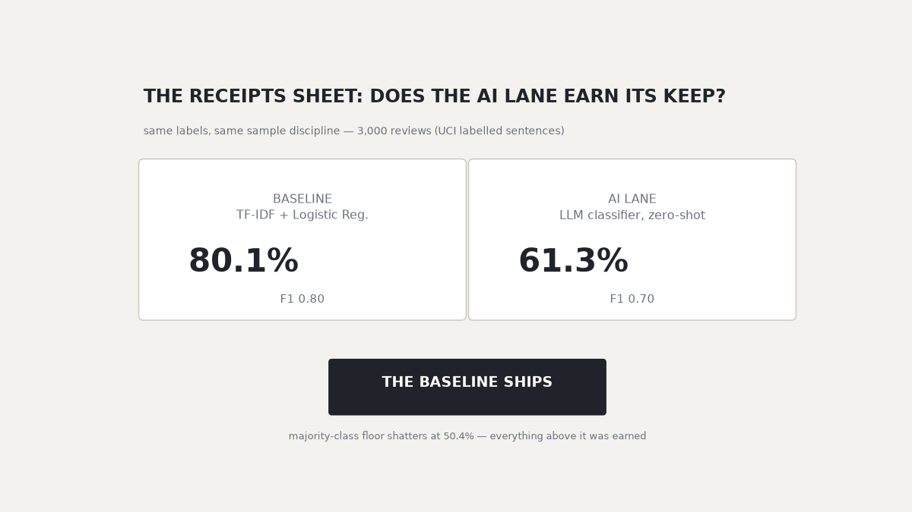

# Review triage: the claim, then the receipts



**The claim** most GenAI portfolios make: "AI classifies reviews."

**The receipts** this folder ships instead — same labels, same sample discipline,
every number written to a JSON file you can open:

| lane | accuracy | F1 | cost | notes |
|---|---|---|---|---|
| majority-class floor | 50.4% | — | free | the number to beat |
| **baseline** — TF-IDF + LogisticRegression | **80.1%** | 0.80 | ~free | holdout, 2,731 examples |
| **AI lane** — LLM zero-shot | 61.3% | 0.70 | per-call | 150-sample eval, `ai_eval.json` |

**Verdict the receipts force: the baseline ships.** The AI lane loses on identical
labels — and that's the *point* of the project: buy accuracy with receipts, not
screenshots. (Counting everything above the floor as "earned" still applies:
the baseline earned its 80.1%.)

Data: UCI Sentiment Labelled Sentences — 3,000 reviews across amazon_cells,
imdb, yelp (public). Baseline per-corpus detail in `model_eval.json`.

## Audit-trail bits (the part most teams skip)

- `ai_classifications_sample.csv` — every AI prediction next to its original text,
  sized for an analyst to spot-check by eye.
- Zero-shot prompts logged verbatim in `insights.md` — no secret prompting.
- No API key? The same harness runs the eval with a deterministic lexicon
  classifier and stamps the receipt `mode: lexicon_fallback (no API key set)`.
  The process is honest even when the lane can't run.


## Try the scorer

```bash
python3 -m venv .venv && .venv/bin/pip install -r requirements.txt
.venv/bin/python src/01_baseline_model.py     # the baseline + holdout metrics
.venv/bin/python src/02_llm_classifier.py     # AI lane eval (key optional)
.venv/bin/python src/03_dashboard.py          # dashboard/index.html

.venv/bin/python src/06_chat.py "baseline vs llm"          # the receipts
.venv/bin/python src/06_chat.py "classify: works great, worth every penny"
.venv/bin/python src/06_chat.py                            # REPL
```

The classify intent applies the same deterministic recipe (`POSITIVE · p=0.89`
style output) to any sentence you paste. Eval receipts come from
`model_eval.json` / `ai_eval.json` at question time — nothing is memorized.


## Limits

Crowd-sourced binary labels carry annotation ambiguity. The AI lane samples 150
rows rather than 3,000 (cost/latency choice; the harness scales up). Outputs are
sentence-level — full-review snippets change the base rates.
